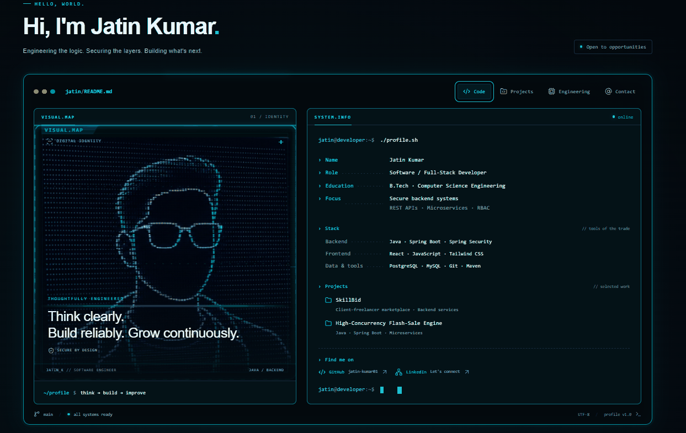

# 👋 Hi, I'm Jatin Kumar

### Software Engineer | Java Backend Developer | Full-Stack Developer

A Computer Science Engineering student focused on building secure, scalable backend architectures and responsive full-stack applications. Passionate about Java, Spring Boot, distributed microservices, and modern web technologies.

---

## 👨‍💻 About Me

- 🎓 **Education:** B.Tech in Computer Science & Engineering
- 💻 **Primary Focus:** Backend Systems & Full-Stack Application Development
- 🌱 **Currently Learning:** Microservices Architecture, System Design and Advanced Spring Boot
- 🔐 **Security:** Spring Security, JWT Authentication and Role-Based Access Control (RBAC)
- 🚀 **Building:** Real-world applications and scalable software solutions
- 🤝 **Open To:** Software Engineering Internships and Backend Developer Opportunities

---
Tech Stack & Technologies

Programming Languages

`Java` `JavaScript` `C` `C++` `SQL`

backend Development

`Spring Boot` `Spring Framework` `Spring Security` `Hibernate` `JPA` `JDBC` `REST APIs` `Microservices`

Frontend Development

`React.js` `JavaScript ES6+` `HTML5` `CSS3` `Tailwind CSS` `Bootstrap`

Databases

`PostgreSQL` `MongoDB`

Tools & Technologies

`Git` `GitHub` `Maven` `Postman` `IntelliJ IDEA` `VS Code`

---

Featured Projects

 1. Flash Sale System
High-concurrency flash sale application built with modern backend and frontend technologies.

**Technologies:** Java, Spring Boot, React, PostgreSQL, Redis, Kafka

[View Repository →](https://github.com/jatin-kumar01/flash-sale-system)

2. AI Generated Projects
A collection of AI-generated web development projects.

**Technologies:** JavaScript, React and modern web technologies.

[View Repository →](https://github.com/jatin-kumar01/ai-generated-projects)

### 3. Other Development Projects

Explore my latest repositories and development work.

[View All GitHub Repositories →](https://github.com/jatin-kumar01?tab=repositories)

---

GitHub Statistics

---

 My Portfolio

Explore my developer portfolio to learn more about my skills, projects and experience.

**[🚀 Visit My Portfolio Website](YOUR_VERCEL_PORTFOLIO_URL)**

---

 Connect With Me

---

⭐ **Thanks for visiting my profile!**

*Always Building | Always Learning | Always Improving*
